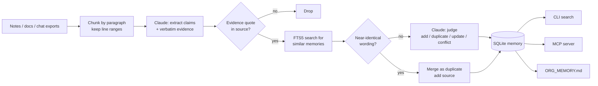

# orgmem

**One shared, cited memory for the whole organisation, so every AI tool knows what the company knows.**

[](https://github.com/SS-XXX-X-MM/orgmem/actions/workflows/ci.yml)


## The problem

Inside most companies, AI use is fragmented. Each person chats with their own assistant, and each team builds its own small AI tool. What gets learned in those places stays there: decisions, who owns what, how things are done. So every new chat starts from zero, and different tools give different answers to the same question.

Company knowledge does exist, but it is spread across meeting notes, Slack threads, handbooks and incident reviews. Much of it is out of date or contradicts itself.

orgmem turns those scattered documents into **one memory layer** that any tool can read. It works like this:

- **Extract**: pull durable knowledge (decisions, processes, ownership, facts, glossary terms) out of notes, docs and chat exports.
- **Ground**: keep a claim only if its quoted evidence really appears in the source. Every memory cites file and line numbers.
- **Consolidate**: merge duplicates, let newer decisions replace older ones (keeping the history), and flag contradictions for a human instead of guessing.
- **Share**: serve the memory to any AI assistant over [MCP](https://modelcontextprotocol.io), or export it as one `ORG_MEMORY.md` file. Assistants can also write back what they learn through the same checks.

## How it works



| Action | When | Effect |
|---|---|---|
| `add` | Nothing similar exists | New memory |
| `duplicate` | Same claim, maybe worded differently | Source added to the existing memory (more corroboration) |
| `update` | Same topic, newer document changes it | Old memory marked *superseded* and linked to the new one; history kept |
| `conflict` | Claims contradict and the dates don't settle it | Both flagged; a human runs `orgmem resolve` |

## Quickstart

```bash
git clone https://github.com/SS-XXX-X-MM/orgmem && cd orgmem
uv sync --all-extras                 # or: pip install -e ".[mcp]"
export ANTHROPIC_API_KEY=...         # only needed for ingest / remember

uv run orgmem ingest examples/acme   # 5 sample docs from a fictional company
uv run orgmem search "can we deploy on friday"
uv run orgmem conflicts
uv run orgmem export                 # writes ORG_MEMORY.md
```

The sample data in [`examples/acme`](examples/acme) contains the cases a memory system has to handle:

- **A decision that changes later.** In March, Friday deploys are frozen. In June, a chat lifts the freeze. Searching for "friday deploy" should return only the June rule, and `orgmem show <id>` lists the March rule under *replaced*.
- **A contradiction.** On the same day, the handbook says Sam owns on-call and the ops notes say Dana does. orgmem can't know which is right, so it flags a conflict instead of picking one.
- **Noise.** "Lunch anyone?" and one-off status updates should not become memories.

### Commands

| Command | What it does |
|---|---|
| `orgmem ingest PATH` | Extract and consolidate memories from a file or folder (`.md`, `.txt`, `.json` chat exports). Unchanged files are skipped. |
| `orgmem search QUERY` | Ranked full-text search over active memories |
| `orgmem show ID` | One memory with every source quote and what it replaced |
| `orgmem conflicts` / `orgmem resolve CID --keep MID` | Review and settle contradictions |
| `orgmem export [-o FILE]` | Markdown snapshot with citations, ready for a system prompt or wiki |
| `orgmem stats` | Counts of memories, sources, documents and open conflicts |
| `orgmem serve` | MCP server over stdio |

Settings: `--db` or `ORGMEM_DB` sets the database (default `.orgmem/memory.db`), `ORGMEM_MODEL` sets the Claude model (default `claude-opus-5-5`), and `ORGMEM_EFFORT` sets the effort level (default `medium`).

## Connect it to your AI tools (MCP)

`orgmem serve` exposes four tools: `search_memory`, `get_memory`, `list_conflicts` and `remember`.

Claude Code:

```bash
claude mcp add orgmem -- uv --directory /path/to/orgmem run orgmem --db /path/to/memory.db serve
```

Claude Desktop, Cursor or any other MCP client:

```json
{
  "mcpServers": {
    "orgmem": {
      "command": "uv",
      "args": ["--directory", "/path/to/orgmem", "run", "orgmem", "--db", "/path/to/memory.db", "serve"],
      "env": { "ANTHROPIC_API_KEY": "sk-..." }
    }
  }
}
```

Reading needs no API key. `remember` sends notes through the same grounding and consolidation as ingested files, so a fact learned in one person's chat becomes available to everyone without duplicating or overwriting what is already known.

## Design decisions

- **Grounding with verbatim quotes.** The extractor must quote its evidence word for word, and code checks that the quote appears in the source text (ignoring whitespace, case and curly quotes). This catches paraphrased or invented "evidence" without a second LLM call, and it is what makes line-level citations trustworthy.
- **Cheap checks before LLM calls.** Similar memories are found with SQLite FTS5 (BM25 ranking), and near-identical wording (word Jaccard ≥ 0.85) is merged without asking the model. The judge LLM only runs when there are real candidates and the case is ambiguous.
- **Contradictions go to a human.** When dates can't settle a disagreement, orgmem flags both claims rather than letting a model decide silently. In company knowledge, a confidently wrong answer costs more than a flagged question.
- **History is never deleted.** An update supersedes the old memory and links to it, so you can always see what changed and when.
- **Oldest documents first.** Ingesting in date order means a later document finds the earlier memory already in place and can be recognised as an *update*.
- **Structured outputs.** The LLM's answers are constrained to Pydantic schemas (`ExtractionResult`, `Decision`), and an invalid `target_id` from the judge falls back safely to `add`.
- **Small interfaces, testable offline.** The pipeline depends on two protocols, `Extractor` and `Judge`. The tests use deterministic fakes for the full pipeline and a mocked HTTP transport for the real SDK path, so CI needs no API key.
- **No infrastructure.** One SQLite file. Nothing to deploy until you need it.

## Project layout

```
src/orgmem/
  ingest.py      load .md/.txt/.json, detect dates, chunk by paragraph with line ranges
  llm.py         Extractor / Judge protocols + Claude implementation and prompts
  pipeline.py    grounding, candidate retrieval, consolidation, ingest orchestration
  store.py       SQLite schema, FTS5 search, supersede / conflict / resolve
  export.py      ORG_MEMORY.md renderer
  mcp_server.py  MCP tools for AI assistants
  cli.py         command-line interface
tests/           28 tests, all offline
```

## Development

```bash
uv sync --all-extras
uv run pytest
uv run ruff check src tests && uv run ruff format --check src tests
```

## Limitations and roadmap

- **Keyword retrieval.** FTS5 misses matches that use different words (e.g. "release" vs "deploy"). Next step: hybrid search with embeddings.
- **Sequential ingestion.** One LLM call per chunk, run one after another. Concurrent calls or the Message Batches API would make large backfills faster and cheaper.
- **Re-ingesting an edited file** adds new evidence but doesn't retract claims that were removed from it.
- **No access control yet.** Every reader sees everything. A real deployment needs per-team scopes before ingesting sensitive sources.
- **Connectors.** Direct Slack, Notion, Google Drive and Linear sync instead of exported files.

## License

MIT
